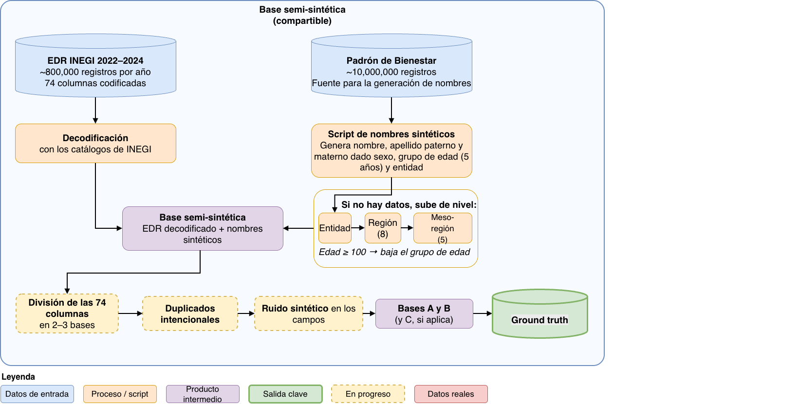

# mx-nombres

Biblioteca de Python para la selección y generación de nombres y apellidos sintéticos a partir de distribuciones observadas en datos públicos de nombres de México (parte derecha del diagrama).

En este repositorio, la biblioteca se utilizó para generar datos que forman parte de mi trabajo de investigación sobre ligado de registros (parte izquierda del diagrama).



## Requisitos

- Python 3.12 o compatible.
- NumPy.
- pandas.

## Instalación

Clona o descarga el repositorio y entra en su directorio raíz.

Instala la biblioteca en modo editable:

```bash
python -m pip install -e .
```

Esta modalidad permite utilizar la biblioteca mientras se desarrolla el código fuente local.

## Uso

### Seleccionar un nombre y apellidos

```python
from mx_nombres import (
    seleccionar_nombre,
    seleccionar_primer_apellido,
    seleccionar_segundo_apellido,
)

nombre = seleccionar_nombre(
    edad_agrupada="De 15 a 19",
    entidad=1,
    sexo="FEMENINO",
)

apellido1 = seleccionar_primer_apellido(
    edad_agrupada="De 15 a 19",
    entidad=1,
    sexo="FEMENINO",
)

apellido2 = seleccionar_segundo_apellido(
    edad_agrupada="De 15 a 19",
    entidad="Aguascalientes",
    sexo="FEMENINO",
)

print(f"{nombre} {apellido1} {apellido2}")
```

El ejemplo selecciona un nombre y dos apellidos para una persona de sexo femenino, de entre 15 y 19 años, de Aguascalientes.

Cuando una función `seleccionar_` recibe los tres campos requeridos, construye una bolsa de selección a partir de los datos disponibles y elige un elemento al azar. Si la bolsa está vacía, intenta obtener candidatos mediante las siguientes alternativas, en orden:

1. Utilizar la región de ocho regiones en lugar de la entidad federativa.
2. Utilizar la mesorregión de cinco regiones en lugar de la entidad federativa.
3. Buscar en el siguiente grupo de edad hacia abajo.

### Uso masivo

La biblioteca también incluye `generar_nombres`, que permite generar nombres y apellidos para múltiples registros a partir de un DataFrame.

```python
import pandas as pd
from mx_nombres import generar_nombres

nombres = generar_nombres(
    df["edad_agrupada"],
    df["entidad"],
    df["sexo"],
    seed=42,
)

df = pd.concat([df, nombres], axis=1)
```

Se supone que `df` ya contiene las filas para las que se desean generar nombres, con las columnas de edad agrupada, entidad y sexo.

La función devuelve un DataFrame con las columnas `nombre`, `apellido_paterno` y `apellido_materno`.

Para conocer más detalles, consulta la implementación de `generar_nombres` en `core.py`.

Un ejemplo más completo se encuentra en `scripts/agregar_nombres_edr.py`.

## Parámetros

| Parámetro | Tipo | Descripción |
|---|---|---|
| `edad_agrupada`* | `str` o `pd.Series` | Grupo de edad al que corresponde cada registro. Se admiten los grupos definidos en `EDADES_AGRUPADAS`, desde `"De 15 a 19"` hasta `"De 120 y más"`. En `generar_nombres`, también se acepta una serie de edades numéricas, que se transforma a grupos de edad. Las funciones `seleccionar_...` esperan el grupo como texto. |
| `entidad`* | `int`, `str` o `pd.Series` | Entidad federativa, indicada mediante su clave numérica o un nombre reconocido por los normalizadores de `mapeos.py`. En `generar_nombres`, se proporciona una serie con una entidad por registro. |
| `sexo`* | `str` o `pd.Series` | Sexo utilizado para filtrar los nombres y apellidos. Se normaliza mediante las funciones de `mapeos.py`. En `generar_nombres`, se proporciona una serie con un valor por registro. |
| `seed` | `int` o `None` | Semilla para el generador aleatorio. Permite reproducir la selección si se mantienen los mismos datos, parámetros y versión del código. Por defecto, `None`. |
| `ponderar` | `bool` | Controla las probabilidades de selección. Si es `True`, los valores se eligen proporcionalmente a su frecuencia observada; si es `False`, todos los valores distintos de la bolsa tienen la misma probabilidad. Por defecto, `True`. |
| `solo_misma_edad` | `bool` | Si es `True`, solo busca candidatos en el grupo de edad solicitado. Si es `False`, permite buscar en otros grupos de edad cuando no encuentra candidatos. La búsqueda geográfica alternativa sigue disponible en ambos casos. Por defecto, `False`. |
| `edad_min` | `str` | Grupo de edad inferior que delimita la búsqueda de grupos alternativos. Por defecto, `"De 15 a 19"`. |
| `edad_max` | `str` | Grupo de edad superior que delimita la búsqueda de grupos alternativos. Por defecto, `"De 80 a 84"`. |
| `max_pasos` | `int` o `None` | Número máximo de grupos de edad vecinos que se consideran hacia abajo y hacia arriba, respectivamente. Si es `None`, no se aplica este límite. Por defecto, `None`. |

Los parámetros `seed`, `ponderar`, `solo_misma_edad`, `edad_min`, `edad_max` y `max_pasos` están disponibles tanto en `generar_nombres` como en las funciones `seleccionar_...`.

### Comportamiento de la selección

La búsqueda se realiza en el siguiente orden:

1. Se intenta encontrar una bolsa para el grupo de edad solicitado y la entidad federativa.
2. Si no existe, se intenta con la región de ocho regiones y después con la mesorregión de cinco regiones.
3. Si `solo_misma_edad=False` y no se encuentran candidatos, se repite la búsqueda con grupos de edad cercanos, alternando grupos inferiores y superiores dentro de los límites establecidos por `edad_min` y `edad_max`.

Las bolsas se construyen conservando únicamente los valores cuya frecuencia observada sea mayor que `MIN_CONTEO`, definido actualmente como `2`. Por tanto, se excluyen los valores con frecuencia igual o inferior a dos.

Si no se encuentra una bolsa válida, la función individual devuelve `None`. En la generación masiva, los registros sin una selección válida quedan sin nombre o apellido.
Los valores disponibles para edad, sexo y entidad dependen de los datos y catálogos utilizados por la biblioteca.

**Nota:** la conversión de una edad numérica al grupo correspondiente está implementada, pero aún no se ha probado.

## Datos

El archivo `src/mx_nombres/data/df_nombres.csv` contiene los datos utilizados para construir las estructuras de selección.

Este archivo se distribuye como parte del paquete, por lo que no es necesario especificar manualmente su ruta para el uso habitual.

Si se necesita cargar otro archivo compatible, la función `recargar` permite reconstruir las estructuras de selección a partir de una ruta:

```python
from mx_nombres import recargar

recargar("/ruta/al/archivo/df_nombres.csv")
```

El archivo alternativo debe contener las columnas requeridas por la biblioteca.

## Estructura del proyecto

```text
.
├── src/
│   └── mx_nombres/
│       ├── __init__.py
│       ├── core.py
│       ├── map_regiones.py
│       ├── mapeos.py
│       └── data/
│           └── df_nombres.csv
├── scripts/
├── notebooks/
├── pyproject.toml
└── README.md
```

- `core.py`: funciones principales para seleccionar y generar nombres y apellidos.
- `map_regiones.py`: asignación de entidades federativas a regiones y mesorregiones.
- `mapeos.py`: catálogos y normalización de entidades federativas y sexo.
- `data/df_nombres.csv`: datos utilizados por la biblioteca.
- `scripts/`: scripts auxiliares y ejemplos de uso.
- `notebooks/`: cuadernos de exploración y análisis relacionados con el proyecto de tesis.


